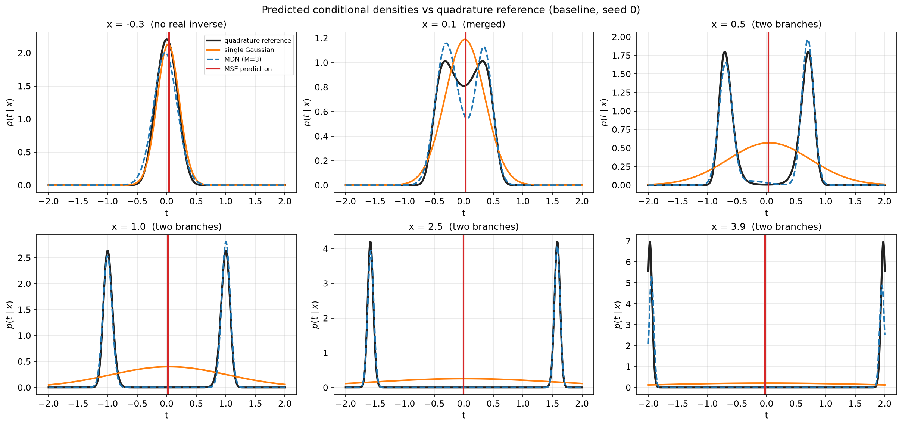
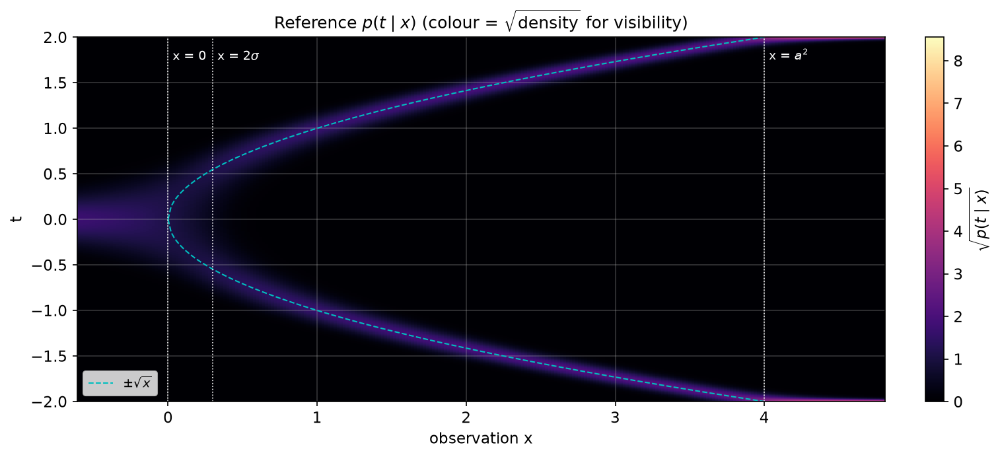
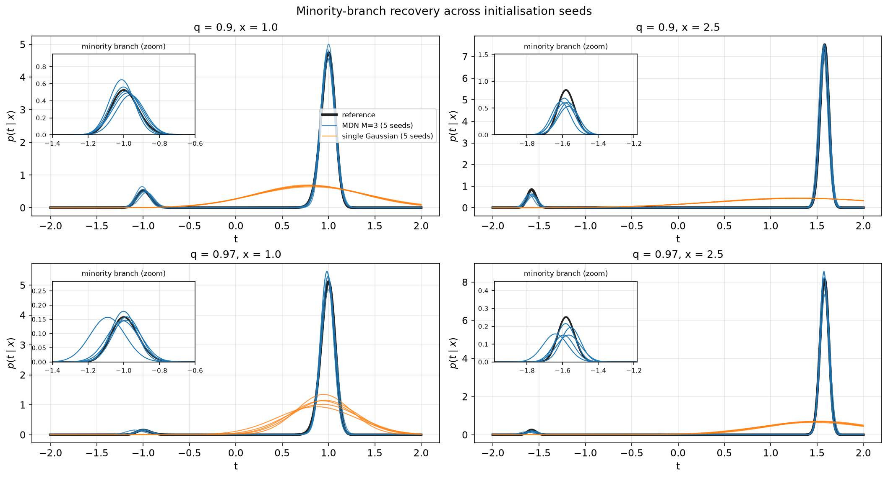
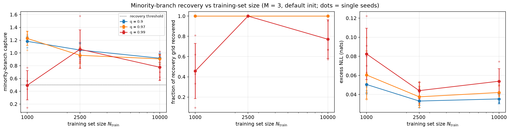
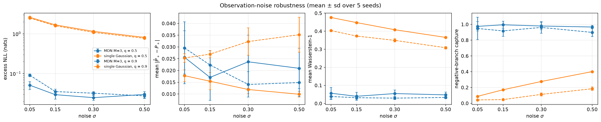

# Inverse problems with multiple valid solutions

**MAC 312: Foundations of Data Science · Project 8** · group project (6 members)

> **In one sentence:** some questions have more than one right answer. We show that an ordinary
> neural network returns the *average* of the right answers, which is itself wrong, while a network
> that outputs *probabilities* finds all of them. We then stress-test it with rare answers and noisy
> data.

📓 **Main deliverable:** [`Project8_Inverse_Problems.ipynb`](Project8_Inverse_Problems.ipynb). It
contains all maths, code, experiments, figures and conclusions, and runs top to bottom from a clean
kernel. Every number below was produced by that notebook.

---

## Contents
1. [The idea, explained simply](#1-the-idea-explained-simply)
2. [The problem, properly](#2-the-problem-properly)
3. [What we trained](#3-what-we-trained)
4. [How we graded the models](#4-how-we-graded-the-models)
5. [Results](#5-results)
6. [The deeper lesson and limitations](#6-the-deeper-lesson-and-limitations)
7. [Repository layout](#7-repository-layout)
8. [How to run](#8-how-to-run)

---

## 1. The idea, explained simply

**The game.** I think of a secret number between −2 and 2. I square it, which makes the minus sign
disappear, add a tiny random wobble, and tell you the result. Say I tell you **1**. What was my
number? It could be **+1** or **−1**. Both are right, because squaring threw the sign away.

**The naive robot (MSE network).** A robot is trained to guess one number and is punished by how far
off it is. Half the time the answer is +1 and half the time −1, so the guess that gets punished least
is in the middle: **0**. But 0² = 0, not 1. The robot always says something that is never a right
answer. It isn't broken; it was asked for one number when there are two answers.

**The smart robot (mixture density network).** It answers with probabilities instead: "50% chance
it's near +1, 50% chance it's near −1." That is exactly the right answer.

**The tricky tests.**

* **Unfair game:** I pick positive numbers 97% of the time. Does the smart robot still remember that
  −1 is possible? Yes, as long as it is allowed to draw at least two "bumps."
* **Blurry game:** I add a bigger wobble. Does it still work? Yes, just a bit less precisely.

**The answer key.** For this game, maths gives the *exact* probabilities, so we can grade the robots
precisely rather than eyeballing them.

<p align="center"><br>
<em>Black: exact answer. Blue dashed: smart robot (MDN). Orange: one-bump model. Red line: naive robot (MSE).</em></p>

---

## 2. The problem, properly

### The generative model

$$t \sim \mathrm{Unif}[-a,a],\qquad x = t^2+\epsilon,\qquad \epsilon\sim\mathcal N(0,\sigma^2)$$

Baseline: $a=2$, $\sigma=0.15$. The task is to infer $t$ from $x$.

The forward map $t\mapsto t^2$ is not injective, so the inverse problem has **no unique solution**.
The right thing to estimate is not a function $x\mapsto t$ but the **conditional distribution**
$p(t\mid x)$.

### The exact posterior (Part 1)
By Bayes' rule, after the constants cancel,

$$p(t\mid x)=\frac{\exp\big[-\tfrac{(x-t^2)^2}{2\sigma^2}\big]}{Z(x)}\,\mathbb 1_{[-a,a]}(t),\qquad
Z(x)=\int_{-a}^{a}e^{-(x-u^2)^2/2\sigma^2}\,du .$$

$Z(x)$ has no elementary closed form, so it is computed with `scipy.integrate.quad`. To keep this stable we
subtract the maximum of the log integrand, split the integral at 0, and give `quad` the peak
locations as break points. Checks: the density integrates to 1, it is symmetric, and the results
don't change with tolerance or a 400 001-point grid. The notebook runs these for the symmetric prior;
`tests/test_reference.py` repeats them for $q=0.9$ and for edge cases.

### Where the solutions are
$\partial_t\log p = 2t(x-t^2)/\sigma^2$, so the stationary points are $t=0$ and $t=\pm\sqrt x$. For
$x>0$, $t=0$ is a local *minimum* of $\log p$ (curvature $2x/\sigma^2>0$), and each branch has local
standard deviation $\sigma/(2\sqrt x)$. For $0<x\le a^2$ the ratio of the valley to the peaks is
$e^{-x^2/2\sigma^2}$ (beyond $a^2$ the peaks sit at $\pm a$ instead), which gives four input regions:

| Region | $x$ | Posterior shape |
|---|---|---|
| No real inverse | $x\le0$ | One mode at $t=0$ |
| Merged | $0<x<2\sigma$ | Two modes, barely separated |
| **Two branches** | $2\sigma\le x\le a^2$ | Clear modes at $\pm\sqrt x$ |
| Beyond support | $x>a^2$ | Modes pinned to $\pm a$ by the prior |

<p align="center"></p>

### The asymmetric prior (Part 5)
$p_q(t)$ puts weight $q$ on $t>0$ and $1-q$ on $t<0$. The likelihood depends only on $t^2$, so
$P(t>0\mid x)=q$ exactly for **every** $x$. This gives the experiments a known target.

---

## 3. What we trained

Every network uses the same small MLP trunk: 1 input, 3 hidden layers of 64 units with tanh, and
standardised $x$. Training uses Adam (lr $2\times10^{-3}$), batch size 256, and gradient clipping at
norm 5, with early stopping on the **validation** loss (patience 40) and the best checkpoint restored.
The data has 10 000 training, 2 000 validation and 2 000 test points; the test set is used only for
reporting.

### (a) MSE network (Part 2)
Outputs one number $f_\theta(x)$ and minimises $\frac1N\sum(f_\theta(x_i)-t_i)^2$. Since

$$\mathbb E[(f-t)^2]=\mathbb E[(f-\mathbb E[t\mid x])^2]+\mathbb E[\mathrm{Var}(t\mid x)],$$

the optimum is the **conditional mean** $\mathbb E[t\mid x]$:

* with a symmetric prior this is **0** everywhere, between the branches;
* with $q=0.9$ it is $\approx(2q-1)\sqrt x = 0.8\sqrt x$, still not on a branch.

Our network reached the Bayes-optimal MSE (1.3388 against 1.3386 for the exact conditional mean). It
is a perfect estimator of a summary that is useless for this problem.

**Extra: absolute-error (MAE) network (notebook §4.1).** The same network trained with $|f-t|$ learns
the conditional **median**. With $q=0.9$ that lands on the majority branch: a valid answer, but only one
of the two. With the symmetric prior the median is 0, but the loss is almost flat across the whole gap, so
the trained networks wander inside it and partly drift onto the $+$ branch (following a 50.8% sign
imbalance in the training sample). Changing the point loss changes *which* single answer you get, never
the fact that there is only one.

### (b) Mixture density network, MDN (Part 3)

$$p_\theta(t\mid x)=\sum_{j=1}^{M}\pi_j(x)\,\mathcal N\big(t\mid\mu_j(x),v_j(x)\big),\qquad
\pi=\mathrm{softmax}(\alpha),\quad v_j=\mathrm{softplus}(s_j)+v_{\min}.$$

Valid weights and positive variances hold by construction. $v_{\min}=10^{-4}$ is a *variance*
floor. The loss is the average negative log-likelihood, evaluated in log space:

$$-\log p = -\operatorname{logsumexp}_j\Big[\log\pi_j-\tfrac12\log(2\pi v_j)-\tfrac{(t-\mu_j)^2}{2v_j}\Big].$$

The naive "sum the densities, then take the log" underflows. We show it returning $-\infty$ at
$t=30$, while logsumexp gives −3105.

### (c) Single-Gaussian network (Part 4 baseline)
This is literally the MDN with $M=1$: the same code, a different $M$. It models uncertainty, but with
only one bump.

### Experiments (~190 networks)

| Experiment | What varies | Runs |
|---|---|---|
| Baseline | $M\in\lbrace 1,2,3,5\rbrace$ × 5 seeds | 20 |
| Asymmetric prior | $q\in\lbrace 0.5,0.7,0.9,0.97\rbrace$ × $M$ × 5 seeds | 80 |
| Initialisation | default vs "spread" starting means, $q\in\lbrace 0.9,0.97\rbrace$, $M\in\lbrace 2,3\rbrace$ | 40 |
| Variance floor | $v_{\min}\in\lbrace 10^{-5},\dots,10^{-1}\rbrace$, $q=0.9$ | 25 |
| Noise robustness | $\sigma\in\lbrace 0.05,0.15,0.3,0.5\rbrace$ × $q\in\lbrace 0.5,0.9\rbrace$ × $M\in\lbrace 1,3\rbrace$ | 80 |
| MSE networks | $q\in\lbrace 0.5,0.9\rbrace$ | 2 |
| MAE (median) networks, §4.1 | $q\in\lbrace 0.5,0.9\rbrace$ × 5 seeds | 10 |

Overlapping settings are trained once and reused. The dataset is fixed by `data_seed`, so only the
initialisation seed varies and the spread across seeds isolates optimisation randomness.

---

## 4. How we graded the models

| Metric | Definition | Why |
|---|---|---|
| **Excess NLL** | test NLL of the model − test NLL of the exact posterior | Estimates $\mathbb E_x[\mathrm{KL}(p\,\Vert\,p_\theta)]$. 0 is perfect |
| **Branch-probability error** | $\lvert\hat P_+(x)-q\rvert$, with $\hat P_+=\sum_j\pi_j\Phi(\mu_j/\sqrt{v_j})$ | Is the sign split right? |
| **Branch capture / recovery** | model mass ÷ reference mass within $\pm\sqrt x\pm3\sigma/(2\sqrt x)$, scored only where two modes exist ($2\sigma\le x\le a^2-2\sigma$). "Recovered" if capture ≥ 0.5 | Measures branches by **probability mass**, not by counting components (components ≠ modes) |
| **Wasserstein-1** | both densities on a common 4001-point grid, `scipy.stats.wasserstein_distance` | How far mass is misplaced, in units of $t$ |
| **Forward residual** | $r=x-\tilde t^2$, with $\tilde t$ sampled from the model | If the model is exact, $r\sim\mathcal N(0,\sigma^2)$. The target is sd ≈ σ, **not 0**, because the data is noisy |

A Gaussian mixture has unbounded support, while the true posterior lives on $[-a,a]$. We report the
leaked mass separately (about 0.7% for the MDN) and truncate only for the grid-based metrics.

---

## 5. Results

### Baseline (symmetric prior, σ = 0.15)

| Model | Excess NLL | W1 | Residual sd (target 0.15) | Test MSE |
|---|---|---|---|---|
| MSE network | n/a | n/a | 1.20 | 1.339 |
| Single Gaussian ($M=1$) | 1.68 | 0.45 | 2.63 | 1.339 |
| **MDN ($M=3$)** | **0.03** | **0.04** | **0.16** | 1.338 |
| Exact posterior | 0 | 0 | 0.15 | 1.339 |

All models have essentially the same MSE, but only the MDN has the right distribution.
Branch probability is about 0.5 for **both** probabilistic models, so a correct sign split does not
imply a correct density.

### Imbalanced prior (Part 5)
* **Every MDN with $M\ge2$ recovered the rare branch, in 60 of 60 runs**, even at 97:3, where only
  about 300 training points lie on that branch.
* It wasn't perfect: minority capture dropped from about 1.0 to about 0.9 (the rare branch is
  slightly under-weighted), and variation across seeds grew with the imbalance.
* $M=1$ **never** recovers it, whatever the seed. This is a capacity limit, not a training problem.
* **What actually breaks recovery:** a variance floor wider than the true branch width
  ($v_{\min}=0.1$: capture 0.43, excess NLL 0.91).
* **MSE can't see any of this:** at $q=0.9$ the MSE is about 0.473 for every $M$, while the excess
  NLL ranges from 0.035 to 1.6.
* **Small-data & extreme imbalance stress test (Rohan's extension, §7.5):**
  * Swept $N_{\rm train} \in \{1000, 2500, 10000\}$ across $q \in \{0.90, 0.97, 0.99\}$.
  * At $N=1000$ and $q=0.97$ (only ~30 minority points), recovery is still **100%**.
  * The collapse threshold occurs when minority points drop to $\approx 10$ ($N=1000, q=0.99$), where default init capture falls to 0.43 (recovery 26.7%).
  * Under this failure regime, **spread initialisation** acts as an effective inductive bias, lifting capture to 0.587 (above the 0.5 recovery threshold).

<p align="center"></p>
<p align="center"><br>
<em>Sample-size stress test: minority capture, recovery rate, and excess NLL vs N_train for q in {0.90, 0.97, 0.99}.</em></p>

### Noise robustness (extension)
* Both branches were recovered at **every** noise level from σ = 0.05 to 0.5.
* Counterintuitively, the excess NLL is **worst at the smallest noise** (0.09 at σ = 0.05, $q=0.9$).
  The branches become very sharp (sd ≈ 0.006), and small width errors cost a lot of log-likelihood.
* The single Gaussian looks *relatively* better at high noise only because the true posterior itself
  gets blurrier.
* At high noise, the prior's jump at $t=0$ shows up in the posterior, and a smooth Gaussian mixture
  can only approximate it.

<p align="center"></p>

---

## 6. The deeper lesson and limitations

A point estimate is just one functional of $p(t\mid x)$: squared loss gives the mean, absolute loss
the median. For a multimodal posterior these can land where the density is nearly zero. Maximum
likelihood instead minimises $\mathrm{KL}(p\,\Vert\,p_\theta)$, which forces the model to put mass on
**every** branch. The MDN's remaining errors sit exactly where the true posterior has features a
Gaussian mixture can't express: hard support edges, the prior's discontinuity at 0, and very sharp
peaks. Truncated mixtures or normalising flows would be natural next steps.

**Limitations.**

* The main sweeps used 10k data points; our sample size stress test (§7.5) explored $N \in \{1000, 2500\}$ and confirmed branch recovery down to ~30 minority points ($N=1000, q=0.97$), locating the failure boundary at $\approx 10$ points ($N=1000, q=0.99$). Network depth/width variations remain an open exploration.
* The capture ≥ 0.5 threshold for "recovered" is our own, fairly lenient definition, so the raw
  capture values are reported too.
* GPU training isn't bit-for-bit deterministic, so retraining without the cache can change the last
  digits of some metrics.

---

## 7. Repository layout

| Path | Contents |
|---|---|
| `Project8_Inverse_Problems.ipynb` | Master notebook: Parts 1–5 + extension, executed |
| `src/p8/reference.py` | Exact posterior via quadrature, modes, region classification |
| `src/p8/models.py` | MSE network and MDN (single Gaussian = MDN with $M=1$) |
| `src/p8/training.py` | Training loop, early stopping, run caching |
| `src/p8/evaluate.py` | NLL, sampling, branch metrics, Wasserstein-1 |
| `src/p8/experiments.py` | Multi-seed sweep helpers |
| `src/p8/data.py`, `config.py` | Data generator, seeding, all settings |
| `tools/build_notebook.py` | Generates the notebook (edit cells here) |
| `tests/sanity_check.py` | Standalone checks of the reference and the MDN |
| `tests/test_reference.py` | Fast standalone tests of the exact posterior (Part 1): numpy and scipy only, runs in seconds |
| `TASK_SPLIT.md` | Who does which part of the project |
| `figures/` | All figures |
| `artifacts/results/` | CSV result tables + `settings.json` |

### Notebook ↔ assignment map

| Notebook section | Assignment |
|---|---|
| §3 Conditional density, quadrature, input regions | Part 1 |
| §4 MSE network, conditional mean, "between the branches" | Part 2 |
| §5 MDN: positivity, normalisation, stable likelihood | Part 3 |
| §6 NLL vs single Gaussian, densities, branch probabilities, residuals | Part 4 |
| §7 Asymmetric prior, $M$, initialisation, variance floor, why MSE fails | Part 5 |
| §8 Branch error, recovery score, Wasserstein-1, noise sweep | Extension |

---

## 8. How to run

```bash
python -m venv .venv
source .venv/bin/activate        # macOS / Linux
# .venv\Scripts\activate         # Windows
pip install torch --index-url https://download.pytorch.org/whl/cu126   # NVIDIA GPU; plain `pip install torch` for CPU / Mac
pip install -r requirements.txt
python -m ipykernel install --user --name scaf-project8
jupyter nbconvert --to notebook --execute --inplace --ExecutePreprocessor.timeout=-1 Project8_Inverse_Problems.ipynb
```

* A full run from scratch trains about 180 small networks: roughly 1.5 h on an RTX 3050 laptop GPU.
* Trained runs are cached in `artifacts/cache/` under a hash of every setting, so re-runs take about
  10 minutes. Delete that folder to retrain from scratch. It is git-ignored, so a fresh clone always
  trains from scratch the first time.
* To change a notebook cell, edit `tools/build_notebook.py`, run `python tools/build_notebook.py`,
  then re-execute.
* Reproducibility: the data is fixed by `data_seed=2026`, model seeds are 0–4, and Python, NumPy and
  PyTorch are all seeded. All settings are saved to `artifacts/results/settings.json`.
